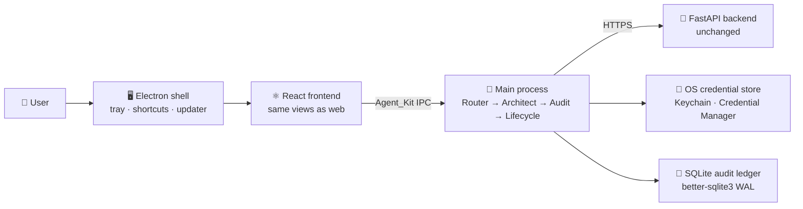

# 🖥️ Desktop App

The **IAM-Dynamic Desktop Security Studio** is an Electron shell around the existing React frontend and remote FastAPI backend. Same policy pipeline, plus a native shell: system tray lease countdown, OS credential store, global capture shortcut, guided tour, and auto-updates.

## 📑 Table of Contents

- [🏗️ How It Fits Together](#-how-it-fits-together)
- [✅ Requirements](#-requirements)
- [🚀 Run in Development](#-run-in-development)
- [⚙️ Configuration](#-configuration)
- [📦 Building Installers](#-building-installers)
- [🔏 Signing and Notarization](#-signing-and-notarization)
- [⌨️ Shortcuts and Tour](#-shortcuts-and-tour)
- [📁 Project Layout](#-project-layout)
- [🛠️ Troubleshooting](#-troubleshooting)

## 🏗️ How It Fits Together



| Layer | Role | Code |
| ----- | ---- | ---- |
| Renderer | Request → review → credentials views, tour, Help, update banner | [`frontend/src/`](../frontend/src/) |
| Main process | Window, tray, IPC, Agent_Kit orchestration, updater, ledger | [`desktop/src/main/`](../desktop/src/main/) |
| Preload bridge | Typed, minimal `window.desktopApi` (no blanket Node access) | [`desktop/src/preload/`](../desktop/src/preload/) |
| Contract | Channel names + payloads; renderer mirror in `frontend/src/types/desktop.ts` | [`desktop/src/shared/ipc-contract.ts`](../desktop/src/shared/ipc-contract.ts) |

Key design decisions:

- **Remote-first backend** — the desktop never bundles Python; it talks to the same `/api/*` endpoints as the web app.
- **Guardrail can only raise risk** — the local deterministic AST check upgrades (never downgrades) the backend's risk verdict.
- **Credentials are memory-only** — temp AWS creds live in the main process for the lease, never on disk; only the JWT session is persisted (in the OS store, never plaintext).

## ✅ Requirements

| Tool | Needed for | Notes |
| ---- | ---------- | ----- |
| Node 22 | Everything JS | Matches CI (`setup-node@v5`, node 22) |
| Python 3 + `pip install pillow` | App icons | Runs [`desktop/build/icon.py`](../desktop/build/icon.py); icons are gitignored build artifacts |
| Xcode + Developer ID cert | macOS `.dmg` signing | Ad-hoc/unsigned builds work without it |
| Docker | Linux `.AppImage`/`.deb` | See [Building Installers](#-building-installers) |
| AWS account + S3 bucket | Windows builds + update feed | On-demand CodeBuild only; see [🔄 Auto-Update](auto-update.md) |

## 🚀 Run in Development

```bash
# Terminal 1 — backend (from repo root)
cd backend && python main.py

# Terminal 2 — renderer with hot reload
cd frontend && npm run dev        # http://localhost:3000

# Terminal 3 — Electron shell (loads the dev server)
cd desktop && npm install && npm run dev
```

> The shell points at `http://localhost:3000` in dev and the bundled `frontend-dist/` in packaged builds (`npm run copy-renderer`).

Useful commands (all run from `desktop/`):

| Command | What it does |
| ------- | ------------ |
| `npm run typecheck` | Typecheck main + preload + contract (CI gate) |
| `npm run build` | Compile to `dist/` |
| `npm run icons` | Regenerate icons into `build/icons/` |
| `npm run dist:mac` | Signed (if certs) arm64 `.dmg` |
| `npm run dist:win` / `dist:linux` | NSIS / AppImage+deb (Windows needs CodeBuild — see below) |

## ⚙️ Configuration

| Variable | Default | Purpose |
| -------- | ------- | ------- |
| `IAM_DESKTOP_BACKEND_URL` | `http://localhost:8000` | FastAPI base URL (main process, read at runtime) |
| `VITE_API_BASE_URL` | `http://localhost:8000` (baked at build) | FastAPI base URL for the renderer — **must be set when building a release** pointing at a hosted backend, since `file://` has no same-origin fallback |
| `IAM_DESKTOP_UPDATE_FEED_URL` | *(unset = updates off)* | Public URL serving releases + `latest.yml` |
| `IAM_DESKTOP_DEV` | *(unset = auto)* | `1` forces dev mode (dev server + DevTools); packaged apps default to production via `app.isPackaged` |
| `CSC_NAME` | *(auto-detect off in CI)* | macOS signing identity (e.g. `Developer ID Application: …`) |
| `APPLE_ID` / `APPLE_APP_SPECIFIC_PASSWORD` / `APPLE_TEAM_ID` | *(unset = skip)* | Apple notarization via `scripts/notarize.js` |

Local dev needs none of these. Release builds need `IAM_DESKTOP_UPDATE_FEED_URL` only when publishing (`-p always` + `-c.publish.*` flags — never baked into `electron-builder.yml`, so local builds can't phone home).

## 📦 Building Installers

| OS | Command | Runs where | Output |
| -- | ------- | ---------- | ------ |
| macOS arm64 | `npm run dist:mac` | M-series Mac | `.dmg` (signed + notarized when creds exist) |
| Windows x64 | CodeBuild, on-demand | AWS (no Windows host needed) | Unsigned NSIS `.exe` + `latest.yml` → S3 |
| Linux arm64 | `npm run dist:linux` | Docker (`node:20` + system deps) | `.AppImage`, `.deb` |

Windows is x64-only by design (keeps CodeBuild minutes down); macOS is arm64-only (Universal was dropped — no Intel test path). NSIS stays until Azure Trusted Signing exists; unsigned installers trigger SmartScreen, which is expected and documented. No PKG/MSIX yet — see the roadmap note in [🔄 Auto-Update](auto-update.md#-future-hardening).

## 🔏 Signing and Notarization

1. **macOS** — `Developer ID Application` cert signs the `.app` (Hardened Runtime + `build/entitlements.mac.plist`); `scripts/notarize.js` staples Apple notarization when `APPLE_ID` credentials are set, otherwise it logs and skips.
2. **Windows** — skipped for now (see above).
3. Verify locally: `spctl -a -vv 'IAM Dynamic.app'` after a signed build.

## ⌨️ Shortcuts and Tour

| Keys | Action |
| ---- | ------ |
| `⌘/Ctrl + Shift + I` | Quick capture from anywhere (desktop global shortcut; focuses the request box) |
| `?` | Open Help & shortcut reference |
| `→` / `Enter` | Advance the guided tour |
| `Esc` | Exit tour / close dialogs |

The first-run tour (Next/Back/Skip, 5 steps) launches once automatically and replays from **Help → Guided tour**. Shortcuts are defined once in [`frontend/src/lib/shortcuts.ts`](../frontend/src/lib/shortcuts.ts) — the Help view renders that registry, so docs can't drift from behavior.

## 📁 Project Layout

| Path | Description |
| ---- | ----------- |
| `desktop/src/main/main.ts` | Window, IPC handlers, tray, global shortcut, single-instance |
| `desktop/src/main/agentkit/` | **Agent_Kit**: `router.ts` (intent + clarifying questions), `audit-risk.ts` (deterministic guardrail), `backend-client.ts`, `index.ts` (orchestrator), `orchestrator` streams `router → architect → audit → done` progress over IPC |
| `desktop/src/main/ledger.ts` | SQLite audit ledger (WAL, versioned migrations, Markdown/JSON export) |
| `desktop/src/main/vault.ts` | OS credential store wrapper (lazy `keytar`, degrades to a clear error) |
| `desktop/src/main/updater.ts` | `electron-updater` wiring — downloads in background, installs only on user restart |
| `desktop/src/main/tray-manager.ts` | Lease countdown title, 5-minute warning, revoke-on-expiry |
| `desktop/src/preload/preload.ts` | `contextBridge` allowlist — the only renderer↔main surface |
| `desktop/build/icon.py` | Generates `icon.{png,ico,icns}` from code (no design tools) |
| `desktop/buildspec-windows.yml` | On-demand CodeBuild spec (S3 cache, NSIS + `latest.yml` artifacts) |
| `desktop/scripts/setup-codebuild.sh` | Creates/updates the CodeBuild project (never starts builds) |
| `desktop/electron-builder.yml` | Packaging: arm64 dmg / x64 NSIS / arm64 AppImage+deb |

## 🛠️ Troubleshooting

| Symptom | Cause / Fix |
| ------- | ----------- |
| Blank/blue window in the packaged app | Renderer assets must use relative URLs (`base: './'` in `vite.config.ts`) — absolute `/assets/...` resolves to `file:///...` and fails. The shell now also renders load errors in-window instead of staying blank. |
| Window can't be dragged | Only the header is a drag surface (`.app-drag`); all header buttons opt out (`.app-no-drag`). Content areas intentionally don't drag. |
| `iconutil: Invalid Iconset` | Sandbox/broken `iconutil` — `icon.py` detects the failure and writes a spec-compliant `.icns` directly (validated with `sips` + Pillow). No action needed. |
| DMG step fails in `dmgbuild`/hdiutil parsing | Environmental (sandboxed shells); the `.app` and `-mac.zip` still build fine — retry `dmg` outside the sandbox. |
| `Cannot reach the backend` toast | `IAM_DESKTOP_BACKEND_URL` wrong or backend down; the error names the URL it tried. |
| Global shortcut doesn't register | Another app owns `⌘/Ctrl+Shift+I`; main logs a warning and the request box still works via click. |
| Native module load errors after Node upgrade | Re-run `electron-builder install-app-deps` (the `postinstall` hook) so `better-sqlite3`/`keytar` match the Electron ABI. |
